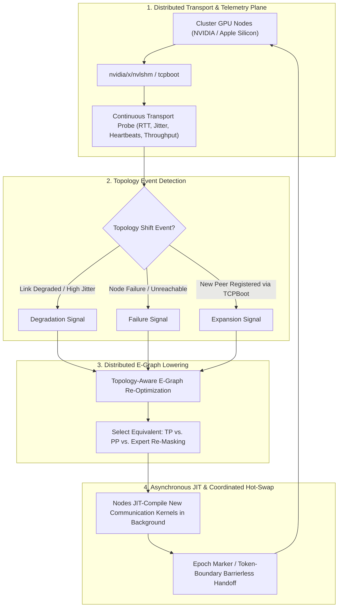

# Design Document: Elastic Topology-Adaptive Distributed JIT for Pure-Go GPU Inference

**Status:** Draft for Peer Review  
**Target Subsystems:** `ccl/topology`, `nvidia/x/nvlshm`, `nvidia/x/moonep`, `x/egraph`  
**Authors:** tmc/lib Architecture Team  

---

## 1. Executive Summary & Problem Statement

Modern distributed LLM inference engines (e.g. Megatron-LM, vLLM, TensorRT-LLM) treat cluster topology as a **static, immutable constraint** established at boot time. The model graph is partitioned using fixed Tensor Parallelism (TP), Pipeline Parallelism (PP), or Expert Parallelism (EP) across a rigid set of GPUs.

This frozen architecture exhibits catastrophic failure modes in real-world heterogeneous or cloud environments:
1. **Network Degradation & Jitter (The AllReduce Stall)**: If a single interconnect link slows down (e.g. thermal throttling on a PCIe switch, packet loss on a 100GbE RoCE interface, or cross-switch hops), high-frequency synchronous collective communication (`AllReduce` after every linear layer in TP) halts the entire cluster, causing throughput to collapse to the slowest link.
2. **Node Dropout & Hardware Failures**: When a single GPU or worker node experiences an unrecoverable failure, the entire collective communicator deadlocks, dropping in-flight generation requests and forcing a full cluster restart.
3. **Elastic Node Joins**: Dynamically adding compute capacity (e.g. bursting onto idle spot instances or newly booted Apple Silicon / NVIDIA nodes via [`nvlshm/tcpboot`](file:///Users/tmc/go/src/github.com/tmc/lib/nvidia/x/nvlshm/tcpboot)) requires tearing down and re-initializing the entire serving topology.

### The Pure-Go Dynamic Distributed Solution
By integrating `tmc/lib`'s lightweight `nvidia/x/` collective transports ([`nvidia/x/nvlshm`](file:///Users/tmc/go/src/github.com/tmc/lib/nvidia/x/nvlshm), [`nvidia/x/moonep`](file:///Users/tmc/go/src/github.com/tmc/lib/nvidia/x/moonep), `tcpboot`), continuous transport telemetry, and the **E-Graph Equality Saturation Optimizer (`x/egraph`)**, we define an **Elastic Distributed JIT Runtime** that re-evaluates and hot-swaps distributed execution topologies on the fly without legacy C++ collective libraries.

---

## 2. Distributed Runtime Architecture & The Topology Feedback Loop



---

## 3. Distributed Graph Rewrite Equivalence Rules (`x/egraph`)

The E-Graph maintains mathematical equivalences across distinct distributed execution strategies:

### 3.1 Tensor Parallelism (TP) $\longleftrightarrow$ Pipeline Parallelism (PP)
When inter-node bandwidth is high ($> 50\text{ GB/s}$ via NVLink or InfiniBand):
$$\text{Output} = \text{AllReduce}\left(X \cdot W_{\text{shard}, i}\right) \quad (\text{TP Fast Path})$$

When transport telemetry detects link bandwidth dropping below threshold ($\tau_{\text{bw}} < 5\text{ GB/s}$) or latency exceeding $\tau_{\text{rtt}} > 2\text{ ms}$:
The E-Graph rewrites the active forward pass to Pipeline Parallelism (PP):
$$\text{Stage}_{k+1} = \text{P2PSendRecv}\left(f_{\text{layer}}(X_{\text{stage}_k})\right) \quad (\text{PP Fallback})$$
*Advantage:* Reduces cross-node network synchronizations from $4 \times \text{layers}$ per token to $1 \times \text{stage}$ per token, bypassing fine-grained synchronization stalls.

### 3.2 Elastic MoE Expert Masking & Pruning (`x/moonep`)
In Mixture-of-Experts (MoE) architectures where experts $E_0 \dots E_N$ are distributed across nodes:
- When **Node $K$ drops or fails health checks**, the coordinator issues a dynamic expert availability bitmask.
- The gate routing kernel (`moe_gate_ext`) is re-compiled/hot-swapped to project top-$K$ selection exclusively over active surviving experts:
  $$\text{GateScores}' = \text{TopK}\left(\text{Softmax}(\text{Gate}(X)) \odot \text{Mask}_{\text{active}}\right)$$
- *Advantage:* Inference continues uninterrupted with zero cluster downtime; surviving experts absorb the forward pass gracefully.

### 3.3 Elastic Node Onboarding & KV Resharding
- When a new node registers via `tcpboot`:
  1. The cluster initiates an asynchronous background state sync (streaming model weight shards and partitioning future KV-cache segments).
  2. Once verified, the coordinator broadcasts a generation **Epoch Marker**.
  3. All nodes transition to the expanded $N+1$ topology simultaneously at the next autoregressive token boundary.

### 3.4 Cross-Platform Substrate Mapping (NVIDIA & Apple Metal)

The distributed runtime operates symmetrically across NVIDIA and Apple Silicon hardware:

| Component | NVIDIA CUDA Architecture | Apple Silicon Metal Architecture |
| :--- | :--- | :--- |
| **Local Memory Substrate** | `cudamem.Slice[T]` (`cuMemAllocAsync`) | `mempool.Slice[T]` (`newBufferWithBytesNoCopy` / UMA) |
| **Inter-Device Interconnect** | [`nvidia/x/nvlshm`](file:///Users/tmc/go/src/github.com/tmc/lib/nvidia/x/nvlshm) (NVLink VMM + NVSwitch Multicast) | `apple/x/metal/metalio` + Thunderbolt / 100GbE TCP |
| **Cross-Device Sync** | `cuStreamWaitValue32` / `cuStreamWriteValue32` | `MTLSharedEvent` / `MTLEvent` |
| **Dynamic JIT Engine** | `nvidia/x/nvrtcx` (`libnvrtc.so`) | `metal.CompileLibrary` (`Metal.framework`) |
| **Live Telemetry Plane** | [`nvidia/x/cudaprof`](file:///Users/tmc/go/src/github.com/tmc/lib/nvidia/x/cudaprof) + `x/perfetto` | [`apple/x/metal/metalprof`](file:///Users/tmc/go/src/github.com/tmc/lib/apple/x/metal/metalprof) (`MTLCounterSampleBuffer`) |

### 3.5 Heterogeneous Cluster Optimization (NVIDIA + Apple Silicon)

The distributed E-Graph uniquely unlocks **cross-architecture heterogeneous disaggregation**:
1. **Disaggregated Prefill / Decode (EPD)**:
   - **NVIDIA DGX**: Compute-bound chunked prefill on dense Tensor Cores.
   - **Apple Silicon Cluster**: Memory-bandwidth-bound autoregressive single-token decode utilizing 192GB+ unified memory at high energy efficiency.
2. **Heterogeneous Speculative Drafting**:
   - Fast local draft generation running on Apple Silicon (Metal / ANE) streaming $K$-token candidate draft trees over `tcpboot` to NVIDIA target verifiers.

---

## 4. Prior Art & Architectural Synergy with `mlx-go-ccl`

This design directly leverages and refines battle-tested concepts developed in [`github.com/tmc/mlx-go-ccl`](file:///Users/tmc/go/src/github.com/tmc/mlx-go-ccl):

1. **Topology Snapshot Diffing (`mgccl/topodiff`)**:
   - Compares successive cluster connectivity snapshots (`topodiff.Diff(from, to)`), generating fine-grained delta operations (`AddPeer`, `RemovePeer`, `DegradeLink`).
2. **Corrective Live Planning (`mgccl/liveplan`)**:
   - Coordinates transition state machines, safe-points, and token-drain procedures (`liveplan.CorrectiveMembershipConfig`) so in-flight requests are not corrupted when nodes shift.
3. **Dynamic Link Selection (`mgccl/linkselect`)**:
   - Dynamic transport carrier scoring across shared memory (`nvidia/x/nvlshm`), direct peer RDMA, and TCP (`tcpboot`), falling back based on live latency/bandwidth probes.
4. **Decoupled Local Steps (`mgccl/diloco`)**:
   - DiLoCo-style asynchronous periodic synchronization, allowing stragglers to execute multiple local decode steps before syncing with the cluster.

---

## 5. Subsystem Components & File Layout in `tmc/lib`

```
tmc/lib/
├── docs/
│   ├── ADAPTIVE_PGO_MEGAKERNEL_DESIGN.md    # Single-Node PGO Specification
│   └── DISTRIBUTED_ADAPTIVE_PGO_DESIGN.md   # This Document
├── ccl/
│   └── topology/
│       ├── doc.go                           # Transport telemetry & health monitoring
│       ├── probe.go                         # Non-blocking RTT and micro-bandwidth pingers
│       ├── monitor.go                       # Drift and failure event detector
│       └── topology_test.go                 # Telemetry loop tests
├── x/egraph/
│   ├── distributed.go                       # Distributed equality rewrite rules (TP <-> PP <-> EP)
│   └── distributed_test.go                  # Equivalence verification tests
└── nvidia/x/nvlshm/tcpboot/
    └── epoch.go                             # Cluster-wide token boundary coordination
```

---

## 6. Reviewer Discussion Points & Open Questions

1. **Topology Transition Granularity**:
   - *Question:* During a live transition from TP to PP under network degradation, should active in-flight KV caches be reshuffled immediately, or should the transition be applied on the next incoming request sequence?
2. **MoE Quality Degradation under Pruning**:
   - *Question:* When an expert node drops, is dynamic Top-K re-masking sufficient for general text generation, or should we support local fallback surrogate weights for critical MLP layers?
3. **Epoch Synchronization Overhead**:
   - *Question:* Can epoch coordination markers be embedded directly into the communication ring buffer header (zero extra network roundtrips) using `nvidia/x/nvlshm` stream events?

---

## 7. Reviewer Sign-Off Template

```markdown
### Distributed PGO Review Feedback
- **Reviewer:** [Session ID / Name]
- **Verdict:** [GREEN / AMENDMENT / RED]
- **Comments on Section 3 (Rewrite Rules):**
- **Comments on Section 4 & 5 (Implementation & Questions):**
```
